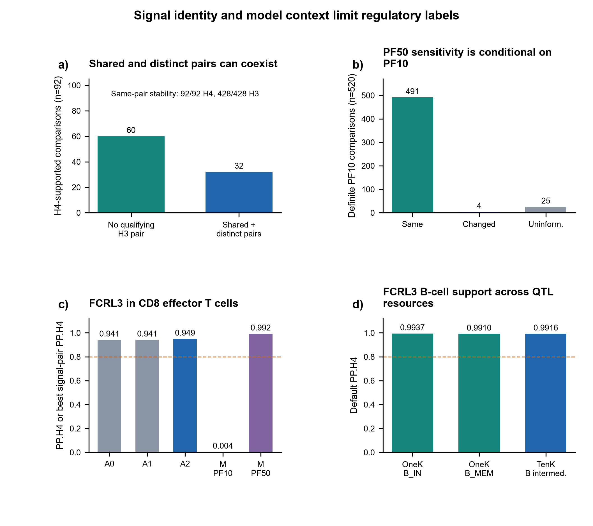

# PBC regulatory attribution reliability

**Input matched multisignal colocalization clarifies regulatory assignments at primary biliary cholangitis loci**

Current project: **PBC, RP v5**. Latest exact-version candidate: **R7C3H1B**, prepared with QiTeng v0.3.24.2 after source-identity and reproducibility closure on **13 October 2026**. The primary GJOKA disease sample size remains the source-matched total `N=24,510`; a frozen 33-comparison effective-N stress test changed no final state or disease credible-set membership. The historical `igan-open-regulatory-evidence` URL is retained for manuscript links and scientific tags; IgAN is archived. This is open research and a submission-review candidate, not a submitted/accepted paper or a verified Zenodo DOI.

## Read the paper and its evidence

| Need | Entry |
|---|---|
| Editable current main manuscript | [DOCX](5_manuscript/current/R7C3H1B/01_Manuscript/Manuscript_SubmissionCandidate.docx) / [25-page WPS PDF](5_manuscript/current/R7C3H1B/01_Manuscript/Manuscript_SubmissionCandidate.pdf) |
| Exact-file author handoff | [Start here](5_manuscript/current/R7C3H1B/START_HERE_精确版本审阅.md) / [13-file SHA-256 list](5_manuscript/current/R7C3H1B/06_QA/UPLOAD_CANDIDATE_MANIFEST.tsv) |
| Detailed current research plan | [RP v5 DOCX](0_admin/research_plans/RP_v5_20261013/PBC_研究计划书_RP_v5_20261013.docx) / [58-page WPS PDF](0_admin/research_plans/RP_v5_20261013/PBC_研究计划书_RP_v5_20261013.pdf) |
| Read figures beside their Results | [25-page WPS review PDF](5_manuscript/current/R7C3H/01_Manuscript/Manuscript_AuthorReview_InlineFigures.pdf) |
| Current figure masters | [Fig1–6 and S1–S3](4_figures/README.md) / [figure gallery](5_manuscript/current/R7C3H/FIGURE_REVIEW_GALLERY.html) |
| Supplement and full aggregate evidence | [Supplement](5_manuscript/current/R7C3H/03_Supplement/) / [Source Data 1–3](5_manuscript/current/R7C3H/05_Source_Data/) |
| Statistical and reproducibility closure | [Executive report](7.Report/rounds/r7c3h0/00_R7C3H0_执行摘要与最终判定.md) / [action record](7.Report/rounds/r7c3h0/99_R7C3H0_详细行动记录_20261013.md) |
| Source-to-panel-to-claim traceability | [34-panel map](5_manuscript/current/R7C3H/06_QA/PANEL_EVIDENCE_MAP.tsv) / [historical ledger crosswalk](5_manuscript/current/R7C3H/03_Supplement/Supplementary_Editorial_Panel_Crosswalk.tsv) |
| Portable snapshot identity check | [Reproduction contract](REPRODUCIBILITY.md) / [SHA-256 manifest](MANIFEST.sha256) |
| Scientific source release | [R7C3H0 GitHub Release](https://github.com/1209433622cz-maker/igan-open-regulatory-evidence/releases/tag/r7c3h0-statistical-reproducibility-closure-2026-10-13) |
| Previous public baseline | [R7C3G1 GitHub Release](https://github.com/1209433622cz-maker/igan-open-regulatory-evidence/releases/tag/r7c3g1-eight-folder-expert-narrative-2026-10-12) |

The HTML gallery can be downloaded with its package and opened locally; GitHub displays its source. Do not upload both manuscript reading variants as separate Main Manuscripts.

## Exact-version handoff

R7C3H1B fixes the FCRL3 TenK Figure 3d pointer, pins scientific code/data links to R7C3H0, and replaces raw exponent/support notation and the two LD definitions with native Word formatting. Figure masters, workbook and all three Source Data ZIPs are unchanged. The SI wording and values are unchanged, with native notation and a new WPS export. Local QA is **43/43**, visual review **32/32 pages**, and the single upload candidate list contains **13 files**. Author identity/declaration confirmation is retained; approval of this exact candidate was received on 13 October 2026; actual portal proof is pending. [Round report](7.Report/rounds/r7c3h1b/99_R7C3H1B_详细行动记录_20261013.md).

RP v5 is a detailed evidence plan, not an authorization to submit. Its earlier abstract count is superseded by the explicit R7C3H1B counting receipt: 126 whitespace words, 129 compound-aware tokens, or 148 conservative alphanumeric pieces; the abstract itself was not edited.

Current candidate publication: [R7C3H1B Release](https://github.com/1209433622cz-maker/igan-open-regulatory-evidence/releases/tag/r7c3h1b-exact-version-handoff-2026-10-13). [Exact-file approval receipt](6_release/r7c3h1b/AUTHOR_APPROVAL_RECEIPT.json) and [publisher-proof next steps](6_release/r7c3h1b/00_R7C3H1C_已批准文件_门户校样下一步.md) preserve the approved ZIP bytes.

## Scientific question and narrative

The study asks when regulatory attribution is stable or changes after input matching, source/model-matched LD and multi-signal decomposition. It separates input-definition effects from causal-assumption effects and tests the consequences using known-truth simulation and bounded external/tissue evidence. The manuscript order is **scope and input contract → matched-input bidirectional reclassification → pair/cell/model sensitivity → simulation gains and losses → external IL12RB2 support → liver detectability and disease-null boundary**.

| Analysis | Frozen result | Interpretation boundary |
|---|---|---|
| PBC-wide screening | 6,923 registered; 5,460 eligible; 1,463 coverage-insufficient | Coverage insufficiency is not a negative result |
| High-information follow-up | 642 comparisons; 47 loci, 200 genes, 14 cells, 286 blocks | 184 primary + 455 H3 rescue + 3 borderline; not all screened comparisons |
| PF10 outcome | 92 H4, 428 H3, 59 model-sensitive, 63 uninformative | Comparison counts are not independent gene discoveries |
| Same-input A2→M | 8 H4→H3; 10 H3→H4 | Real-data reclassification is not a known-truth error rate |
| Pair-specific meaning | 32 H4-supported comparisons also have distinct pairs | One shared pair does not make all regional signals shared |
| PF10/PF50 sensitivity | 491/520 same; 4 change; 25 uninformative | FCRL3/CD8_ET is a retained model-sensitive counterexample |
| Simulation | 486,000 iterations; 160,782 pair-evaluable (33.08%) | Discovery adequacy and conditional inference are separate |
| Simulation trade-off | False sharing 12.41%→8.56%; shared recovery 32.99%→26.66% | No universal algorithm superiority |
| Liver tissue | 5 PBC versus 5 controls; targets detected | Both corrected q≈0.111; no PBC-specific enrichment |

OneK1K/TenK10K evidence is cross-resource molecular-QTL support using the same PBC GWAS. FinnGen is an external disease-study system, but participant non-overlap is unknown. IL12RB2 NK disease-eQTL/caQTL support and a **PBMC** peak-gene link do not establish NK-specific chromatin mediation. R12/R13 are correlated sequential releases. Known IL12RB2/FCRL3 genes are examples, not new causal discoveries or treatment mechanisms.

## Eight-directory repository

```text
0_admin/       protocols, decisions, environments, source and publication audits
1_data/        input-source metadata and large-file identities
2_code/        scientific workflows and figure/document/verification scripts
3_results/     compact reviewed aggregate results and QA
4_figures/     current Fig1–6/S1–S3 masters and historical figures
5_manuscript/  current exact-byte candidate and immutable previous versions
6_release/     release receipts, version identities and download routes
7.Report/      detailed action reports and next-stage decisions
```

[Directory map](0_admin/docs/EIGHT_FOLDER_MAP.md) · [old→new path and unchanged-byte map](0_admin/audit/r7c3g1/PATH_MIGRATION_AND_PRESERVATION.tsv) · [evidence and future reuse](0_admin/docs/CURRENT_EVIDENCE_AND_REUSE.md).

All pre-existing tracked file bytes survive at mapped locations. Historical tags/Releases retain their original layouts; no history was rewritten. Frozen historical scripts/documents keep stage-specific local paths and old conclusions. Use the current state and migration map instead of treating those as current instructions. SSc, MG and IgAN remain archived, with their negative evidence and engineering assets retained.

## A retained counterexample



Figure 3 keeps the FCRL3/CD8_ET PF10/PF50 reversal visible. The manuscript uses it to expose model sensitivity, alongside supported B-cell contexts, rather than treating all strong regional eQTL as the same mechanism. Vector masters and full legends are in the manuscript package.

## Reproduction, inputs and quality

Read [REPRODUCIBILITY.md](REPRODUCIBILITY.md) before running a scientific stage. Reconstruct raw inputs from [source manifests](1_data/README.md); raw BAM/PLINK genotypes, donor matrices, large LD arrays, installed environments and copyrighted papers are not mirrored. Their local identities are recorded, with provider terms retained. See [data availability](DATA_AVAILABILITY.md).

```powershell
python 2_code/00_repository/verify_repository.py
```

The verifier checks canonical Git blobs. Scientific stage environments and fixed input contracts are preserved. Current portable checks resolve paths from the repository root and write outside the checkout; raw-data scientific stages still require the documented local inputs. R7C3H has 38/38 deterministic endpoint replay checks, 26/26 exact-version package checks, 4/4 WPS exports and 57/57 pages visually reviewed. Its 6 main + 3 supplementary figures comprise 34 traceable panels and remain byte-identical to R7C3G. Source Data 3 adds the bounded disease-N stress test. GitHub synchronization does not itself rerun or validate raw scientific fits.

## Authors, licences and disclosure

Zhi Chen (first author, [ORCID](https://orcid.org/0009-0001-0072-5576)) and Teng Qi (corresponding author, [ORCID](https://orcid.org/0009-0007-7648-4776)), School of Medicine, The Chinese University of Hong Kong, Shenzhen. Correspondence: tengqi@link.cuhk.edu.cn. Confirmed author identities and no-funding/no-competing-interest declarations remain in the manuscript. Generative AI assistance is disclosed under author responsibility; repository publication is not an author signature on publisher forms.

Original code: [MIT](LICENSE). Original author-owned text, figures, documentation and shareable aggregate outputs: [CC BY4.0](LICENSE_CONTENT.md), subject to [NOTICE](NOTICE.md). Third-party inputs retain their provider terms. No donor-level data or source access credential is published by this restructuring.

## Current decision

**PBC = GO. R7C3H1B local handoff and QA are complete; exact-version author approval is recorded; publisher-generated PDF proof remains pending**, followed by an author-operated npj Genomic Medicine submission and recorded receipt. New biological candidate screening and global simulation reruns remain out of scope without a concrete scientific defect. No submission, acceptance, new experiment or DOI is claimed by this release. [Current state](0_admin/CURRENT_PROJECT_STATE.json).

